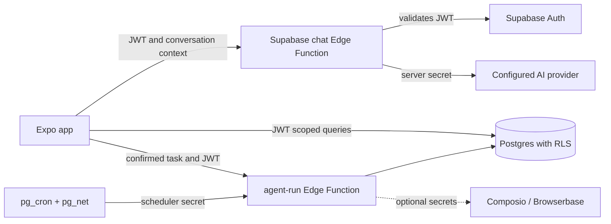

# Architecture

## Runtime

- Expo SDK 57, React Native 0.86, React 19, TypeScript, Expo Router.
- File routes live in `src/app/`; reusable components are in `src/components/`.
- `src/constants/colors.ts` is the graphite and warm-amber token palette. The current interface is dark-only; light/system theme selection is not implemented yet.
- Expo Go provides the quickest offline device preview. EAS development and preview profiles are configured for native builds.

## Feature layout

| Area | Responsibility |
| --- | --- |
| `src/app/(tabs)` | Chat, persisted activity, idea CRUD, scheduled task UI, settings |
| `src/components/common` | Header, avatar, history drawer, agent editor, message previews |
| `src/services/chatHistory.ts` | Local AsyncStorage preview and authenticated Supabase conversation data |
| `src/lib/scheduledTasks.ts` | Task persistence, pause/resume, invocation of the schedule function |
| `src/lib/supabase.ts` | Single Supabase client and public environment configuration |
| `supabase/migrations` | Auth-owned Postgres tables, indexes, constraints, and RLS |
| `supabase/functions/chat` | JWT validation, input validation, server-side AI provider request |
| `supabase/functions/agent-run` | Scheduled and explicitly requested task execution; optional Composio and Browserbase providers |

## Trust boundaries

1. The mobile app contains only the Supabase URL and public anon/publishable key. Public keys are not authorization; RLS is the data boundary.
2. Chat and user-triggered task execution require a Supabase user access token. The server resolves the user from that token and does not trust a user ID in the request body.
3. `chat` validates the user JWT, limits message count and size, and reads `OPENAI_API_KEY` from the Edge Function environment. It returns generic provider errors and does not log prompt content.
4. The `agent-run` function requires a user JWT for direct execution. The cron-only `run_due_schedules` mode requires a separate `SCHEDULER_SECRET`. Do not use the service-role key as the cron bearer secret.
5. Conversations, ideas, profiles, scheduled tasks, and activity have owner-scoped RLS. Conversation message rows use a composite foreign key to ensure their thread belongs to the same user.
6. Composio, Browserbase, and AI provider credentials belong in server secrets. Never add them to `EXPO_PUBLIC_*`, app config, or the app bundle.

## Data model

`profiles`, `chat_threads`, `chat_messages`, `ideas`, `scheduled_agent_tasks`, `agent_tool_runs`, `tools`, and `user_tool_connections` are defined in the core migration. User rows reference `auth.users(id)`. The `tools` catalog is empty by default; no connector is represented as connected unless a live connection record is returned.

## Request flow

## Known architecture limits

- Chat responses are request/response, not streaming. No agent tools are exposed through chat. The assistant must not claim that a suggested action ran.
- `src/app/api/*` contains the adapted Expo API routes used by the reference connector flow. Native production hosting is not configured here; connector linking needs a separately hosted trusted API or a Supabase Edge Function implementation.
- The current `agent-run` function is inherited and only becomes active when its provider secrets and cron setup are completed. Its third-party integrations have not been verified against real accounts.
- No database connection was available during implementation, so migration syntax, RLS behavior, and Edge Function deployment still need to be verified against a real Supabase project.
