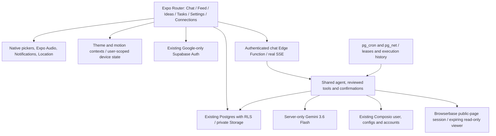

# TARS product upgrade: stabilisation evidence and implementation proposal

**Historical proposal:** the owner subsequently supplied `c6db3729-3f22-4c2b-8756-9a96d3e0f9e4/Pasted text.txt`, explicitly authorizing implementation without another plan-approval pause, and again chose **Keep Gemini**. That supersedes the approval gate below. Current implementation/evidence is tracked in `IMPLEMENTATION_2026-11-04.md`.

Updated 4 November 2026, India time. This is the review document requested before further large feature expansion. Gemini remains the selected provider, explicitly confirmed by the owner; references to OpenAI in the supplied master prompt do not override that decision.

## Scope and preservation

Continue the existing Expo application and Supabase project `bdswodobwesadjedzhfg`. Preserve Google-only authentication, account identities, conversations, tasks, connected accounts, RLS and private storage. No new Supabase project, credential rotation, connection replacement or destructive schema migration was performed in this audit pass. The working tree contains substantial earlier work; unrelated changes were not reverted.

Voice, attachments, reminders and a Composio-backed Maps path were implemented before the latest approval gate. They are existing work under review, not proof that the new master prompt is complete. Further service-specific previews, direct Maps APIs, navigation restoration and a broader redesign need the plan approval requested by the owner.

## Current architecture and feature inventory

| Area | Inspected implementation | Verification limit |
|---|---|---|
| Runtime | Expo 58.0.17, RN 0.88, React 19.3, Router 58.0.25, strict TS 6 | Native installed builds not tested |
| Navigation | Five tabs, sidebar, tools screen, protected Google-only routes | Last-valid-screen restoration is absent |
| State | React screen state, theme/motion/toast contexts, AsyncStorage, Supabase | Unsent drafts are not durable across thread changes |
| Chat | Persistent main/side threads, SSE, Stop, safe Retry, Copy, Revise, Markdown/code/tables | Revise is a new prompt; dedicated regenerate is absent |
| AI | Server-side Gemini, bounded retries/timeouts, tool signatures and persistence | A successful request cannot guarantee future upstream availability |
| Connections | Existing stable user IDs, fresh hosted links, ACTIVE checks, reviewed tools | Config presence alone is never counted as execution success |
| Browser | Actual extraction, execution milestones, owned preview renewal, mobile viewport | Physical iPhone WebView acceptance pending |
| Tasks | Cloud agent schedules, pause/edit/run/history, leases; separate device alerts/reminders | Physical delivery and all task UI controls not fully retested |
| Media | Expo Audio, camera/photo/document pickers, mixed private uploads, signed playback, bounded Gemini analysis | Text upload verified; native media paths pending |
| Maps | Composio toolkit/config, route result validation, route card and exact directions URL | Direct Routes/Places and native route geometry are not implemented |
| Profile/theme | Profile/avatar settings, light/dark/system tokens, native iOS symbols/tabs | Current photo save, Dynamic Type and VoiceOver pending |
| Storage/data | 14 public tables with RLS, two private buckets; generated DB contracts | Historical fingerprint comparison remains distinct from permissions checks |

## Four reference repositories

Reference trees are isolated under `references/`, excluded from production Metro, TypeScript, lint and application test discovery. Their dependencies were not installed and their setup scripts were not executed.

| Repository | Inspected revision | Licence evidence | Native adaptation |
|---|---|---|---|
| dickwu/apple-design-skill | `ff4ebdd` (28 Oct) | No standalone licence found. README “Origin and license” says HIG text belongs to Apple and guidance is supplied as-is; do not label this MIT | Review hierarchy, spacing, platform conventions, touch targets and accessibility; retain source attribution, no wholesale content copying |
| emilkowalski/skills | `f1090be` (2 Nov) | Actual LICENSE: MIT, copyright 2026 Emil Kowalski | Purposeful press/sheet/gesture feedback, interruption, easing and reduced motion |
| thesysdev/open-intelligent-ui | `16ef264` (26 Oct) | Actual LICENSE: MIT, copyright 2026 Thesys Inc. | Typed component library, streamed validated data, source actions; native components instead of Next/DOM/OpenUI execution |
| Dooy/chatgpt-web-midjourney-proxy | `634f8f5` (29 Sep), v2.26.8 | Actual `license`: MIT, copyright 2023 Dooy | Composer previews/removal, cancellation, streaming and near-bottom scrolling; no Vue/backend/proxy/media-generation migration |

The Apple and Emil references are guidance repositories without root application packages. Open Intelligent UI uses Next 16.3.1, React 19, OpenUI, Zod and MapLibre; Dooy uses Vue 3, Vite 4, Pinia and browser media libraries. These are incompatible application foundations for a direct native port. No third-party application source was copied in this audit. Preserve the relevant MIT notices if later implementation copies or adapts source, and document the exact files. Apple-origin guideline text requires separate care.

## Bug findings and repairs

| Finding | Cause / action | Status |
|---|---|---|
| `expo-file-system` bundle failure | Two TARS Metro processes served different graphs on IPv4 and IPv6. Stopped only confirmed TARS listeners and ran one dual-stack server. Installed file-system package already exists; no fake shim | PASS: both HTTP bundle checks; user hard reload reached sign-in, then chat |
| Reference checkout broke `npm test` | Bare `node --test` discovered nine reference tests requiring unrelated web dependencies | Fixed: scope application test script to `tests/*.test.cjs`; no reference dependency installation |
| References could enter tooling graph | New checkouts must remain separate | Metro blocklist and global ESLint reference exclusion; existing TS exclusion retained |
| Thread/account change retained component state | Expo Router can reuse chat screen, including pending request and attachment state | Key conversation state by owner and route; unmount aborts stream/upload. Same-user token refresh retains state; delayed initial session cannot overwrite newer auth event |
| Out-of-order conversation reads | Earlier async load could replace a newer load | Load revisions ignore obsolete success/error/finally results |
| Raw tool names in live status | `tool.started` rendered internal slug directly | Human-readable provider activity driven only by real tool-start events |
| Gemini 503 | Previous models failed full chat despite lightweight probe passing | Existing remote model set to Gemini 3.6; full-agent, cron and current interactive reply tests PASS. No fabricated fallback |
| Last active screen not restored | Welcome/callback always route to Chat | FAIL against new requirement; proposed phase 7 implementation |
| Service-specific previews missing | Current generic execution cards hold basic validated results | FAIL against new requirement; proposed typed renderer, not arbitrary model HTML |
| Direct Maps and route geometry absent | Existing Maps path uses Composio and no native map | BLOCKED on direct API setup and approved implementation |
| Sidebar refresh/delete review | History list refresh is not explicitly tied to every opening; web deletion uses native Alert | Source finding requiring targeted reproduction; do not claim fixed or delete user chats to test |

Earlier task-section nesting and web confirmation bugs were fixed before this audit pass. Their regression checks remain in the test suite.

## Actual signed-in localhost acceptance

Tested the existing owner's Chrome session at `http://localhost:8081/chat` on 3 November, approximately 23:46–23:50 IST. These are fresh actions, not just saved historical results.

| Scenario | Status | Actual evidence |
|---|---|---|
| Google sign-in | PASS, user-observed | Owner completed Google authentication; authenticated chat/history visible. No authentication bypass |
| Gemini natural reply | PASS | Fresh three-sentence planning answer appeared incrementally and completed with Copy/Revise; no 503 in this request |
| Reddit read | PASS | `REDDIT_GET_ME_PREFS`, completed, `log_HsTi0VxyaqsB`; returned language and night-mode preferences |
| X read | PASS | `TWITTER_USER_LOOKUP_ME`, completed, `log_ijN2pjI2b5W5`; returned actual username |
| Trello read | PASS | `TRELLO_GET_MEMBERS_BOARDS_BY_ID_MEMBER`, completed, `log_RWOFoGOXP2Pu`; zero boards returned |
| Jira read | PASS | `JIRA_SEARCH_ISSUES`, completed, `log_t7U_AjAE4MSy`; zero assigned issues returned |
| Execution cards | PASS, tested scope | Four completed cards rendered before final summary; expanded Jira showed verified-account milestone and zero-record result |
| Browserbase read | PASS | Fresh `browse_page` completed for Example Domain; final explanation appeared |
| Mobile live viewer | PASS on web | Open Live Browser displayed actual remote mobile page, not a screenshot mock; Done returned to the same chat |
| Text attachment | PASS | Plus → Long text → attach → private upload → message file link → Gemini returned exact synthetic code `LANTERN-482` and Tuesday review task |
| Dark theme/composer | PASS, tested viewport | Dark surfaces/text remain readable; microphone beside Send, plus left; composer above navigation |
| Physical iPhone layout/motion | BLOCKED | Chrome evidence does not prove native safe areas, gestures or release frame rate |
| Voice/camera/photos/device reminders | BLOCKED for device acceptance | Permission, audio interruption/playback and OS delivery require installed phone builds |
| Google Maps real route | BLOCKED | No successful direct Routes/Places request or native route geometry yet |

Database readback confirmed the latest three chat requests completed with no error code, and all four provider executions plus Browserbase completed without an error message. Test request references include `mw10f7gc_wj0l1wkvxb` (four providers), `mw10gkst_e5ai7jorj7h` (browser) and `mw10izu9_10gta3a5oddi` (attachment). No tokens, keys or provider payloads were copied into this report.

## Automated and backend evidence

- Latest baseline: 69 application tests PASS. Two added conversation-boundary tests PASS: route/account isolation with same-user refresh stability, and delayed initial-session ordering. Final combined count is recorded after rerun below.
- Application and Edge TypeScript and lint passed the previous full check; new chat fixes have a fresh application typecheck PASS. Final lint/typecheck rerun is recorded below.
- Earlier production web/iOS/Android export PASS predates the latest chat refinements; do not treat it as a current native install or physical acceptance result.
- Real pg_cron → pg_net → deployed agent-run → Gemini → Postgres PASS: exactly one saved reply, next occurrence persisted, lease released, only tagged fixtures removed.
- Transactional profile/chat/messages/tasks/history/confirmation and new attachment/reminder isolation checks PASS; fixtures rolled back.
- Historical row-fingerprint comparison FAIL because authorised execution/chat metadata changed. That is not proof of deletion. Permission-only tests explicitly mark historical preservation NOT TESTED; old baseline was preserved and a separately named current snapshot captured.
- Prior client artifact secret scan: 22 files, three known local server credentials checked, zero matches. This is limited to those artifacts/credentials, not a guarantee about every remote secret.
- Dependency audit baseline remains 27 findings (1 low, 23 moderate, 3 high). No forced framework upgrades were made; native compatibility/security remediation needs a separate reviewed change.

## Proposed architecture after approval

Keep the existing app, authenticated Edge boundary and Gemini transport. Add validated discriminated result envelopes: provider, kind, title, summary, retrieval timestamp, execution state, source URL/deep link and bounded provider-specific data. Server adapters project actual provider fields; the mobile renderer selects a fixed native component. Reject unknown kinds and unsafe URLs; never execute model-generated JSX, HTML or expressions. Plain questions keep plain streamed text.

Use Composio APIs for supported service reads and confirmed writes. Browserbase handles explicit browsing or genuinely unsupported website interactions. Do not use it for Maps calculations or ordinary connected-service retrieval. Measure server selection/provider/total latency and client first-delta/render timing using content-free request IDs. Parallelize only independent reads.

Service components: Gmail inbox/message rows, Reddit post/comment groups, Slack message/thread previews, Jira issue rows, Trello board/list/card summaries, Notion page previews and Calendar event rows. Display missing fields honestly, paginate when necessary, and attach exact original-source actions only when backed by returned IDs/URLs. A zero-result response remains an empty state, never invented sample content.

Design: extend existing semantic tokens and native system typography/SF Symbols; maintain light/dark/system appearance and 44-point targets. Reuse native tabs, safe areas, shared keyboard form layout, accessible sheets, Reanimated and Gesture Handler. Test expanded text, screen-reader labels/focus, reduced motion/transparency, keyboard reachability and cancelability. No new branding, ornamental gradients or wholesale screen replacement.

Navigation: persist validated last tab and conversation ID separately per authenticated user; save destinations only, never transient loading/error state. Restore owned, available conversations; invalid/failed routes fall back to clean Chat. Preserve history. Clear private in-memory state and owned device notifications on sign-out, without deleting cloud records.

Maps: server-only Google Routes and Places adapters; resolve ambiguous places, request traffic-aware alternatives when supported, validate real durations/distances/polylines. Native renderer draws only returned geometry and exact official directions URLs. Composio Maps remains separate existing work until migration acceptance; do not silently replace it or claim its OAuth config enables the direct APIs.

Media/reminders: retain existing implementation, then verify and repair it rather than duplicating pipelines. Private owner/thread Storage, signed retrieval, bounded multimodal Gemini analysis, reviewed native permissions, actual OS scheduling readback and cloud/device status separation. Local notifications cannot guarantee sound through Silent/Focus; no entitlement-dependent alarm guarantee.

## Dependencies and credentials

No new runtime dependency was installed in this audit pass. Already installed: Expo Audio 58.0.11, Document Picker 58.0.4, File System 58.0.13, Image Picker 58.0.10, Location 58.0.20, Notifications 58.1.7, DateTimePicker 9.2.1, Reanimated 4.7.1, Gesture Handler 3.3, Blur, Haptics, Symbols and WebView. Patched fflate 0.8.3 is server/test-only. Lockfile retained. Native plugin changes from earlier implementation require rebuilding the application.

Potential dependency after approval: an Expo-58-compatible native map renderer, assessed using Expo installation validation and licensing/provider terms before addition. No Next.js, Vue, MapLibre web, Thesys key generation, proxy backend or unrelated media-generation packages. The installed Google Sign-In package appears unused by the actual browser-OAuth code path; verify config/build usage before any removal.

Existing Gemini, Composio, Browserbase and Supabase credentials stay server-side/in their current supported locations; none need to be pasted into chat. Do not change existing auth-config IDs or connected accounts.

For direct Maps, enable **Routes API** and **Places API (New)** in the chosen Google Cloud project, enable billing, and configure a restricted server-side key. Proposed Edge secret name: **`GOOGLE_MAPS_API_KEY`**. Restrict it to the required APIs; do not ship an unrestricted server key to mobile. A native Google Maps renderer may additionally require separately platform-restricted iOS/Android keys and bundle/package/signing setup. Those keys are a distinct configuration, not the server key. The current audit has not verified direct Maps credentials/billing.

Physical acceptance needs access to installed current iPhone and Android builds, user-operated OS permissions, and Google/Composio consent where necessary. No new paid notification service is needed for ordinary local reminders.

## All phases and release gates

| Phase | Present status | Required completion and acceptance |
|---|---|---|
| 1 Repository/references | PASS for architecture/reference inspection; inventory above | Preserve attribution, no production reference imports, resolve remaining targeted audit findings |
| 2 Existing stabilisation | PASS for tested core chat/four reads/browser/text path; other cases NOT TESTED/BLOCKED | Logout/restart/expiry, all task controls/profile/theme/history, failures, Stop/Retry and regression; fix reproducible critical bugs before expansion |
| 3 Native design | Existing baseline; broader change awaiting approval | Token consistency, icons/type, sheets/gestures, light/dark, accessibility and physical motion acceptance |
| 4 AI/router/browser | Core Gemini path PASS; optimisation pending | API-first routing, bounded parallel reads, genuine progress, timings, session cleanup and failure tests |
| 5 Service previews | NOT IMPLEMENTED to full prompt | Validated native per-service components, real data, empty/error states and pagination |
| 6 Direct Maps | BLOCKED on setup and approval | Real Places/Routes, actual alternatives/geometry/traffic and native/fallback directions tests |
| 7 Navigation restoration | FAIL against requested behaviour | Per-user last valid tab/thread, invalid-state fallback, sign-out isolation and restart tests |
| 8 Attachments | Text end-to-end PASS; remainder pending | Camera/photos/files/mixed/large/long text, upload failure/retry, exact original retrieval and restart |
| 9 Voice | Source implemented; device acceptance BLOCKED | Permission denial, recording animation, pause/resume/cancel, interruption, upload/playback and restart |
| 10 Tasks/notifications | Real cloud cron PASS; device acceptance BLOCKED | Local/recurring/snooze/edit/cancel/timezone/app-closed delivery; honest cloud vs phone states |
| 11 Source redirection | Basic safe URLs exist; expanded actions pending | Exact source mapping and native/web fallback for each real returned item; no guessed links |
| 12 Regression | Automated/backend evidence above; full acceptance incomplete | All required scenarios on current installed iPhone and Android builds, plus failure/restart/accessibility checks |
| 13 Delivery | This audit/proposal delivered; final delivery pending | Updated feature matrix, licences, code/dependencies/migrations/config changes, actual evidence and unresolved blockers |

No phase is silently omitted. A pending device/credential-dependent scenario is not a PASS. This document is the concrete architecture/dependency/credential proposal for the owner's requested approval before further large implementation.
